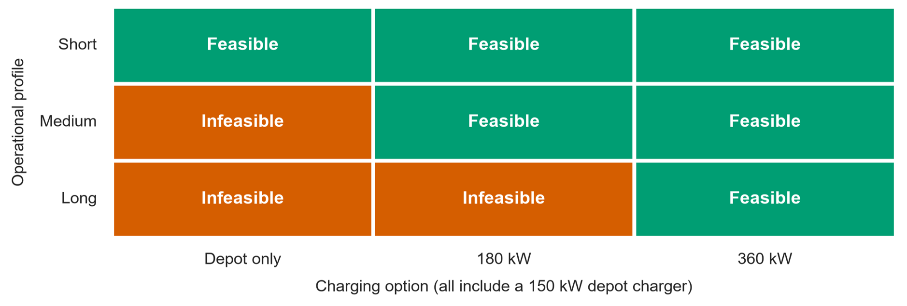

# TIL6022 - TIL Python Programming Project Group 21

Members: Andrea De Felice, Magdalini Karataraki, Stella Nestori, Fernando Quiros, Yiying Sandra Zhu Zhou

Student numbers: 6591973, 6794629, 6811523, 5237076, 6615201

# Introduction

**Context & Relevance**

The transition towards more sustainable transport systems is an important part of addressing climate change and reducing greenhouse gas emissions. In the European Union, heavy-duty vehicles, including trucks, buses and coaches, are responsible for more than 25% of road transport greenhouse gas emissions, despite representing only about 2% of vehicles on EU roads (European Commission, 2026). Furthermore, transport activity is expected to increase, therefore reducing the environmental impact of transport has become an important challenge for the transport sector (European Environment Agency, 2026).  

One potential approach to reducing these emissions is the electrification of heavy-duty vehicles. Replacing conventional diesel trucks with electric alternatives can contribute to the decarbonization of freight transport. However, the transition involves more than simply replacing one type of vehicle with another. The integration of electric trucks into existing transport oeprations also requires suitable charging infrastructure to ensure that vehicles have sufficient energy to perform their scheduled duties. The availability, location, and charging capacity of infrastructure therefore play an important role in determining whether electric trucks can be practically intergated into daily logistics operations.  

In particular, charging opportunities need to align with the operational schedules of freight transport. Trucks may be able to recharge between working days, but this may not always provide sufficient energy for more demanding daily oeprations. Charging during scheduled stops, such as loading and unloding periods, could offer an additional opportunity to replenish the battery. Consequently, understanding the relationship between transport schedules and charging opportunities is important when assessing the feasibility of electric trucks in existing logistics networks.  

These challenges are particularly relevant in port environments, where freight transport connects maritime activities with inland networks. In ports, there are substantial truck movements between terminals, distribution centers and other destinations, which makes electrification of trucks operating in and around ports an important consideration. In this context, the Port of Rotterdam (PoR) can serve as a relevant case for examining the potential and challenges of freight electrification.  As a major logistics hub, it accommodates different types of hinterland truck operations that vary in distance, frequency, and daily schedules. According to Smart Freight Centre (2024), approximately 55% of the port's hinterland container transport is carried by trucks, resulting in around 10,000 truck movements to and from the port each day. These movements involve a variety of transport distances, with some trucks performing multiple relatively short trips and others undertaking longer journeys. The report also indicates that approximately 74% of truck trips to and from the port fall within a distance of 250km. This illustrates the diversity of truck operations in the port area and suggests that different operational profiles may have different energy requirements and charging needs.  

# Research Objective

The objective of this project is to determine which representative truck duties serving the Port of Rotterdam can be completed with depot charging alone and which require additional opportunity charging during scheduled dwell periods. A common set of vehicle specifications is applied to the three representative operational profiles, short, medium, and long-distance to examine how differences in travel distance, number of round trips, and charging opportunities affect feasibility. 

The analysis considers two requirements. The first is duty feasibility: whether the truck can complete its scheduled driving and dwell events without its battery falling below the minimum state of charge. The second is repeatable daily feasibility: whether the truck can also restore its initial battery level before the next day’s departure. We compare depot charging alone with two configurations that additionally allow opportunity charging at 180 kW and 360 kW. 

The analysis also examines how changes in energy consumption, destination dwell time, and port-terminal dwell time affect the results. This allows the sensitivity of the simulated configurations to selected operating assumptions to be assessed. The aim is to identify the conditions under which each charging configuration can support individual truck duties and provide a starting point for more detailed charging infrastructure studies. 

**Research questions**

*Main research question*

For representative short-, medium-, and long-distance truck duties serving the Port of Rotterdam, which can be completed with overnight depot charging alone, and which require additional opportunity charging during scheduled dwell periods at origin and destination? 

*Sub questions*

What are the daily driving energy requirements of the representative short-, medium-, and long-distance truck duties? 

Which combinations of operating profile and charging configuration allow the truck to complete its daily duty without falling below the minimum state of charge? 

For the configurations that allow completion of the daily duty, is the remaining time before the next departure sufficient to restore the battery to its initial state of charge using depot charging? 

How sensitive is duty feasibility to changes in energy consumption, destination dwell time, and intermediate port-terminal dwell time?

**Geographical and temporal scale**

This project focuses on road freight logistics operations connecting the PoR. These operations are represented by short-, medium-, and long-distance duties, with different trip distances and numbers of round trips per day. The PoR is assumed to be the origin and final return point for all duties, with destinations represented by their distance from the port rather than specific geographical locations. The depot is also assumed to be located at the port. 

The model considers a 24-hour cycle, starting at 09:00 with the battery at 90% state of charge. This cycle includes the daily transport duty, consisting of driving and loading or unloading periods, followed by the time available for depot charging. The next departure is scheduled for 09:00 the following day. The analysis therefore checks both whether the truck can complete its duty and whether it can restore its initial battery level before the next departure. 

# Data Used

Starting with the data collection phase, a preliminary assessment of electric truck operations serving the Port of Rotterdam was conducted and some representative values have been collected from Smart Freight Centre (2024) to have a realistic set of numbers to define the simulated trucks and charging configurations. They act as the baseline values for the model. Additional assumptions were established to define the operating schedules, battery limits, and charging conditions within the scope of the model.

| Parameter | Base value | Basis |
|---|---:|---|
| Nominal battery capacity | 540 kWh | Smart Freight Centre (2024) |
| Energy Consumption | 1.7 kWh/km | Smart Freight Centre (2024)  |
| Average driving speed | 60 km/h | Smart Freight Centre (2024) |
| Destination dwell time | 0.75 hours (45 minutes) | Smart Freight Centre (2024) |
| Intermediate dwell time | 0.75 hours (45 minutes) | Model assumption |
| Duty start | 09:00 | Smart Freight Centre (2024) and model assumption |
| One-way distance: Short / Medium / Long | 30 / 92.5 / 187.5 km | Midpoints of Smart Freight Centre (2024) distance bands |
| Round trips: Short / Medium / Long | 3 / 2 / 1 | Smart Freight Centre (2024) |
| Minimum / maximum / initial SOC | 10% / 90% / 90% | Model assumption |
| Charging efficiency | 90% | Model assumption |
| Depot charging power | 150 kW | Model assumption informed by Smart Freight Centre (2024) |
| Opportunity charging power | 0 / 180 / 360 kW | Tested alternatives; PoR/SFC references |
| Opportunity charger availability | All eligible dwell events | Model assumption |
| Final return | Duty ends; no additional terminal dwell | Model assumption |
| Next departure | 24 hours after duty start | Model assumption |

# Data Pipeline

1. Data collection 

    a. truck-specific assumptions (battery capacity, electricity consumption) 

    b. operational profile parameters (route distances, trips per day) 

    c. charging configurations (charging power) 

2. Data preparation: format all input parameters into required structures 

3. Computation:  

    a. Create relevant functions such as decreasing battery over trip execution, estimating time needed to complete charging etc. 

    b. Create events of truck duties 

    c. Process each truck profile under different scenarios defined above 

4. Simulation: keeping track of the energy consumed and available 

5. Evaluation: assessing feasibility and computing performance metrics 

6. Visualisation: SOC trajectories, feasibility outputs, sensitivity plots 

# Methodology

# Results

*Energy requirements*

The simulation of energy requirements of representative short, medium, and long-distance truck services in the PoR, shows significant differences in daily energy requirements. With the operational parameters given, the short distance profile (180 km) requires 306 kWh, in contrast, the medium distance (370 km) requires 629 kWh, while the long-distance duty (375 km) requires 637.5 kWh. 

The short-distance duty requires less energy than 432 kWh of usable battery energy within the operating SOC range of 10% to 90%, making depot only charging feasible. In contrast, medium, and long-distance duties require 629 kWh and 637.5 kWh, respectively, exceeding the nominal battery capacity (540 kWh) and requiring opportunity charging during daily operations. 

*Feasible configurations*

Figure 01. En-route feasibility by operational profile and charging modality 

 

 

Figure 02. Repeatable daily feasibility with overnight depot charging 

 

Figure 01 and Figure 02 present the en-route and repeatable feasibility across the three operational profiles and charging configurations. The short-distance duty is feasible under all configurations, whereas the medium-distance duty requires at least 180 kW opportunity charging, and the long-distance duty requires 360 kW opportunity charging. Both matrices show identical feasibility results, indicating that all configurations capable of completing the daily duty can also recover their initial SOC through overnight depot charging before the next duty. Therefore, overnight recharging does not introduce an additional feasibility constraint under baseline conditions. 

 

 

Figure 03. Minimum recorded SOC by profile and charging configuration 

Figure 03 compares the minimum recorded SOC for each operational profile and charging configuration, using the feasibility threshold. The short distance duty maintains a minimum SOC of 33.3% with depot-only charging, increasing to approximately 80% with opportunity charging. For the medium-distance duty, the minimum SOC increases to 41.0% with 180 kW charging, and to 60.9% with 360 kW charging. In contrast, the long-distance duty remains below the minimum threshold under depot-only and 180 kW charging, while 360 kW charging maintains a minimum SOC of roughly 16.9% providing a limited margin above the threshold, just 6.9 percentage points above the threshold. 

 

 

Figure 04. SOC trajectories by daily operations 

Figure 04 presents the SOC trajectories throughout the daily operations. Short distance duties remain above the minimum threshold even without opportunity charging. For medium-distance duties, depot-only charging becomes insufficient during the second-round trip, while intermediate charging maintains operational feasibility. Long-distance duties depend on the single destination charging opportunity, where only the 360 kW configuration provides sufficient energy to complete the return trip. 

*Sensitivity analysis*

 

The sensitivity analysis evaluates how changes in energy consumption, destination dwell time, and port terminal dwell time affect the minimum SOC threshold and operational feasibility. A total of 180 simulations were performed, varying one parameter at a time across three operational profiles and three charging configurations. These include 72 simulations for energy consumption and 54 simulations for each dwell time parameter (destination and port-terminal), while the remaining parameters were maintained at their baseline values. 

The tested values were selected within predefined minimum and maximum around the baseline assumptions, using equally spaced intervals to assess changes in operational feasibility. 

| Parameter | Values tested |
|---|---:|
| Energy Consumption | 0.500, 0.929, 1.357, 1.786, 2.214, 2.643, 3.071, 3.500 kWh/km |
| Destination dwell time | 0.25, 0.50, 0.75, 1.00, 1.25 and 1.50 hours |
| Port terminal dwell time  | 0.25, 0.50, 0.75, 1.00, 1.25 and 1.50 hours |

Figure 05. Sensitivity of minimum battery SOC to energy consumption 

Figure 05 shows the relationship between energy consumption (kWh/km) and minimum SOC (%) for each operational profile. Higher energy consumption generally reduces the minimum SOC, particularly for medium and long-distance duties. The short-distance duty remains feasible with opportunity charging throughout the tested range, while depot-only charging becomes infeasible at approximately 2.6 kWh/km. For the medium-distance duty, the 180 kW configurations fall below the minimum threshold at approximately 2.2 kWh/km, whereas 360 kW charging maintains feasibility up to approximately 3.1 kWh/km. The long-distance duty is more sensitive, with 360 kW charging falling below the threshold at approximately 2.21 kWh/km. 

Additionally, for the medium-distance profile, some fluctuations in minimum SOC occur because the simulation stops when the SOC falls below the threshold. Higher energy consumption may therefore cause earlier termination and a higher recorded minimum SOC, rather than an actual improvement in battery performance. 

Figure 06. Sensitivity of minimum battery SOC to destination dwell time. 

Figure 06 illustrates how minimum SOC changes as destination dwell time increases from 0.25 to 1.5 hours. For short-distance duties, the minimum SOC remains above 30% with depot only charging and approximately 80% with opportunity charging. For medium-distance duties, 360 kW charging reaches approximately 61% minimum SOC with 0.5-hour dwell, while 180 kW charging increases from approximately 11% to 54.3% as dwell time increases. For long-distance duties, 360 kW charging becomes feasible with approximately 0.75 hour of destination dwell, whereas 180 kW charging requires approximately 1.5 hours. 

Figure 07. Sensitivity of minimum battery SOC to port terminal dwell time. 

Figure 07 shows the impact of increasing port terminal dwell time from 0.25 to 1.5 hours. Short distance duties remain feasible under all charging configurations, with no significant improvement from longer dwell periods. For medium-distance duties, the minimum SOC with 180 kW charging increases from approximately 26% to 54.3%, while 360 kW charging reaches approximately 60.9% with a 0.50-hour dwell. In contrast, the long-distance duty shows no changes in minimum SOC because its operational schedule includes only one round a trip without intermediate port terminal charging opportunities. 

# Conclusion

The simulation results indicate that the energy requirements of representative truck duties differ significantly across operational profiles. Short-distance duties can be supported by the available battery energy, whereas medium and long-distance duties exceed the usable battery capacity, making additional charging necessary under the baseline assumptions. 

Regarding duty feasibility, overnight depot charging is sufficient for short-distance profile, while medium-distance profile is feasible with 180 kW opportunity charging and long-distance profile is feasible only with 360 kW. These findings suggest that the charging requirements are influenced not only by energy demand, but also by the availability of charging opportunities throughout the daily operation. 

Regarding repeatable daily feasibility, all configurations capable of completing their duties can also restore the initial % SOC before the next departure. Therefore, overnight depot charging did not introduce an additional constraint in the baseline simulations. 

The sensitivity analysis indicates that operational feasibility is dependent on the parameters used (energy consumption and the availability of charging opportunities). Longer dwell periods can improve feasibility, but their effectiveness depends on the operational schedule and charging power. Therefore, the feasibility of electric truck operations cannot be assessed from distance alone within the simulated profiles, since trucks with similar daily energy requirements may need different charging configurations depending on the frequency and duration of available charging opportunities. 

Overall, the study provides a preliminary assessment of charging feasibility for three representative freight operations serving the PoR, based on selected technical and operational assumptions. Within the simulated conditions, depot-only charging is sufficient for the short-distance duty, whereas medium and long-distance profiles require additional opportunity to charge at different power levels. The sensitivity analysis provides relevant information on how changes in energy consumption and dwell times affect operational feasibility within the scope of the model. 

# Discussion

The findings provide a basis for extending the current simulation towards a broader assessment of charging infrastructure in the PoR. Future developments could incorporate simultaneous truck movements, charging demand across different terminals, charger availability, and operational constraints. By integrating these factors, the model could move beyond individual duty feasibility to estimate the number and distribution of charging points required to support electric freight operations at the port network level. 

Several limitations should be considered when interpreting these findings. First, the simulation used three representative operational profiles with fixed distances, travel speeds, and schedules. Although these profiles provide a basis for comparison, they do not capture the full diversity of truck operations serving the PoR, including variations in traffic conditions, vehicle loads, and daily travel patterns. 

Second, the model assumes constant energy consumption, charging power, and charging efficiency. It also excludes real conditions as unavailable chargers during scheduled dwell times, queues, or waiting times. In practice, variations in energy consumption, charging performance, and infrastructure availability could reduce energy recovered and affect operational feasibility.  

Furthermore, the sensitivity analysis is limited to test truck specifications and representative operating conditions; therefore, it evaluates individual truck duties rather than simultaneous charging requirements of multiple vehicles as determining for example, the number of chargers required to serve the overall freight network. 

# Contribution Statement

*Be specific. Some of the tasks can be coding (expect everyone to do this), background research, conceptualisation, visualisation, data analysis, data modelling*

**Author 1**:

**Author 2**:

**Author 3**:

**Author 4**:

**Author 5**:
